<p align="center">
  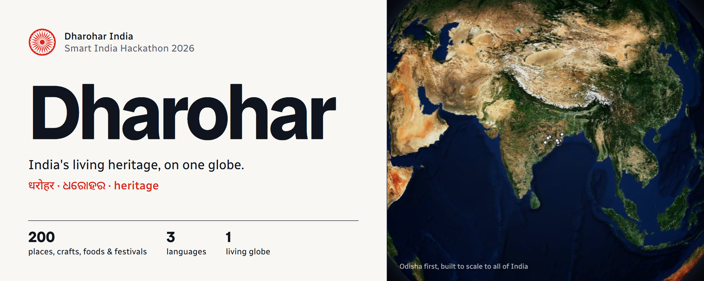
</p>

<p align="center">
  <b>A 3D globe of India's living heritage.</b> Temples, crafts, dances, festivals, foods, people and legends,<br>
  each placed where it began, linked to the others, and explained by an AI guide in English, Hindi and Odia.
</p>

<p align="center">
  <a href="#01--the-globe">Features</a> &nbsp;·&nbsp;
  <a href="#run-it">Run it</a> &nbsp;·&nbsp;
  <a href="#how-it-works">How it works</a> &nbsp;·&nbsp;
  <a href="#api">API</a> &nbsp;·&nbsp;
  <a href="#data">Data</a> &nbsp;·&nbsp;
  <a href="#design">Design</a> &nbsp;·&nbsp;
  <a href="./DOCKER.md">Docker guide</a>
</p>

<br>

| 200 | 8 | 37 | 3 | 1 |
|:--|:--|:--|:--|:--|
| heritage records | categories | curated links between them | languages: English, हिन्दी, ଓଡ଼ିଆ | satellite globe you can fly down to the ground |

Built for **Smart India Hackathon 2026**. Odisha is the first state on the globe; the data model, the map and the interface are built to take in the rest of India.

---

## Contents

**Features**
[01 The globe](#01--the-globe) ·
[02 Satellite to the ground](#02--satellite-to-the-ground) ·
[03 Every record where it began](#03--every-record-where-it-began) ·
[04 Records and their links](#04--records-and-their-links) ·
[05 The category index](#05--the-category-index) ·
[06 The 2D map](#06--the-2d-map) ·
[07 Darshak, the AI guide](#07--darshak-the-ai-guide) ·
[08 Trip planner](#08--trip-planner) ·
[09 Personalised map](#09--personalised-map) ·
[10 Heritage quiz](#10--heritage-quiz) ·
[11 Heritage passport](#11--heritage-passport) ·
[12 Explore](#12--explore) ·
[13 Share a story](#13--share-a-story) ·
[14 Three languages](#14--three-languages) ·
[15 Opening screen](#15--opening-screen) ·
[16 On a phone](#16--on-a-phone)

**Project**
[Run it](#run-it) ·
[How it works](#how-it-works) ·
[API](#api) ·
[Data](#data) ·
[Security and resilience](#security-and-resilience) ·
[Design](#design) ·
[Project structure](#project-structure) ·
[Roadmap](#roadmap) ·
[Credits](#credits) ·
[License](#license)

---

## 01 — The globe

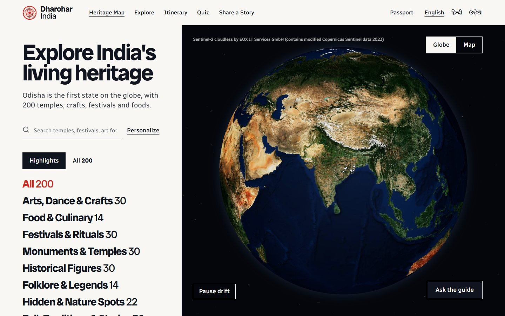

The home page is a real 3D Earth, turned to India, with the heritage records marked on it.

- **Arrival.** On load the camera sweeps in from deep space and settles over India.
- **Flight.** Choosing a record flies the camera along an arc: it rises, travels and comes down close over the place. Dragging the globe takes over from any flight.
- **Markers** pop in one after another, keep the same size on screen at any zoom, and the chosen one carries a slow red pulse.
- **Idle drift.** Left alone, the globe turns slowly on its own; a *Pause drift* button stops it.
- **Starfield and atmosphere.** A quiet field of stars sits far behind the Earth, with a thin blue edge of atmosphere at the limb.
- **Globe and Map.** One toggle switches between this 3D globe and a flat [2D map](#06--the-2d-map).
- **Reduced motion.** For people who ask their system for less motion, the globe opens straight on India and nothing drifts, sweeps or pulses.

## 02 — Satellite to the ground

<table>
  <tr>
    <td width="50%">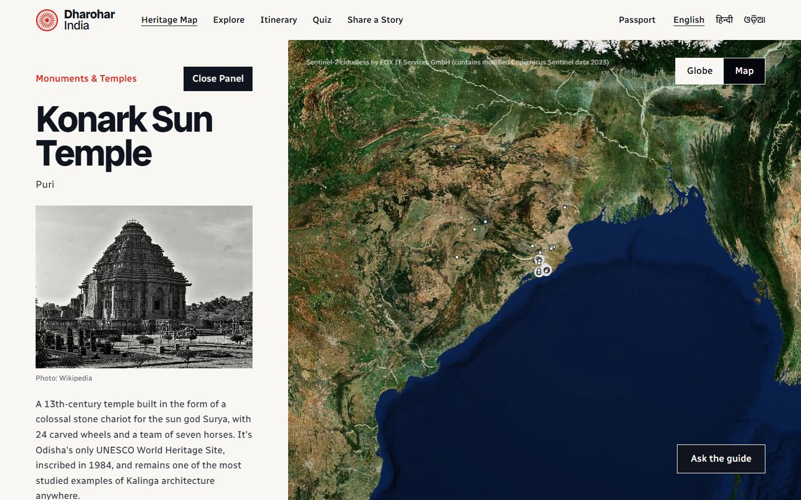</td>
    <td width="50%">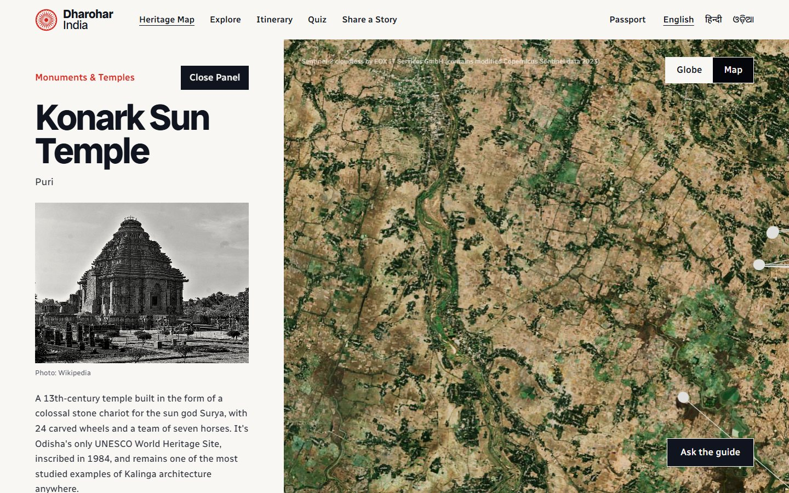</td>
  </tr>
  <tr>
    <td>Choosing Konark Sun Temple: the camera lands over the east coast.</td>
    <td>Scrolling in: the fields, rivers and village tracks around Konark.</td>
  </tr>
</table>

The globe streams **Sentinel-2 cloudless** satellite imagery (EOX, 2023) the way map globes do: a pyramid of image tiles, with sharper ones loading only for the part of the Earth in view.

- From the whole planet down to a few kilometres above the ground, at about 10 m per pixel at the closest zoom.
- Built on [`3d-tiles-renderer`](https://github.com/NASA-AMMOS/3DTilesRendererJS) inside the same react-three-fiber scene as everything else, so markers and link arcs sit exactly on the imagery.
- The surface is lit like the rest of the globe, so the day and night sides still read. The still Blue Marble Earth sits just beneath and shows while tiles load.
- Close to the ground, dragging slows down so you pan the view instead of spinning the planet, and the camera's near plane follows the altitude so the surface is never clipped.
- The imagery source is a setting: any XYZ tile server works (see [`frontend/src/config/satellite.js`](frontend/src/config/satellite.js)), for example Esri World Imagery for building-level detail.

## 03 — Every record where it began

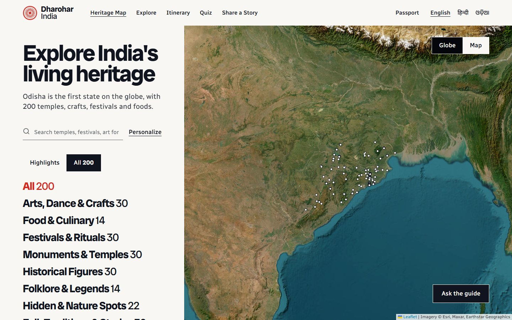

All 200 records sit at their **place of origin**: monuments at the monument, a dish where it comes from, a person at their birthplace or seat, a ritual at its temple.

| Record | Placed at | Why |
|:--|:--|:--|
| Chhena Jhili | Nimapada | Odisha Tourism names it typical of Nimapada |
| Ghumura | Bhawanipatna | the war-dance of Kalahandi |
| Rukuna Rath Yatra | Lingaraj Temple | the chariot festival of Lingaraj |
| Kapdaganda Shawl | Niyamgiri hills | woven by Dongria Kondh women there |
| Gangadhar Meher | Barpali | the poet's home town |
| Duduma & Rani Duduma | Duduma Waterfalls, Koraput | the falls themselves |

- Coordinates come from **Wikidata** and **OpenStreetMap**, never from memory. Ten places with no entry in either are estimated from the nearest town and marked `"approximate": true`.
- Records that share a place, such as the many Jagannath rituals in Puri, sit in a small ring about a kilometre around it, so every marker stays clickable.
- One file is the source of truth: [`data/entity_locations.json`](data/entity_locations.json). The data build uses it, the database is filled from it, and the frontend trusts it.

## 04 — Records and their links

<table>
  <tr>
    <td width="36%">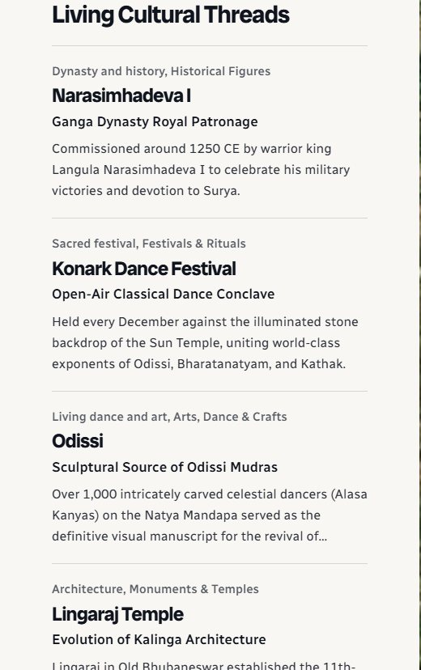</td>
    <td>

Choosing a record opens its panel in the left column, rising into place:

- **The record:** its category, name, place and a photograph from Wikipedia, shown in duotone.
- **Living Cultural Threads:** the curated links to other records, each with its kind (*Dynasty and history*, *Sacred festival*, *Living dance and art*, *Architecture*), a title and a short piece of lore. On the globe, each link draws itself as an arc from the record outward, then a small light keeps travelling along it.
- **Regional foods** from around the place.
- **Verified community opinions:** visitors' ratings, visit times and travel tips, which anyone can add.
- **Actions:** *Ask Dharohar AI Guide* about this record, *Mark visited* for the passport, *Listen* to the record read aloud, and *Read on Wikipedia*. Each link offers *Follow Cultural Arc*, which flies to the linked record.

Konark Sun Temple, for example, links to Narasimhadeva I (the king who built it), the Konark Dance Festival, Odissi (its carved dancers became the dance's source) and the Lingaraj Temple (the architecture it grew from).

  </td>
  </tr>
</table>

## 05 — The category index

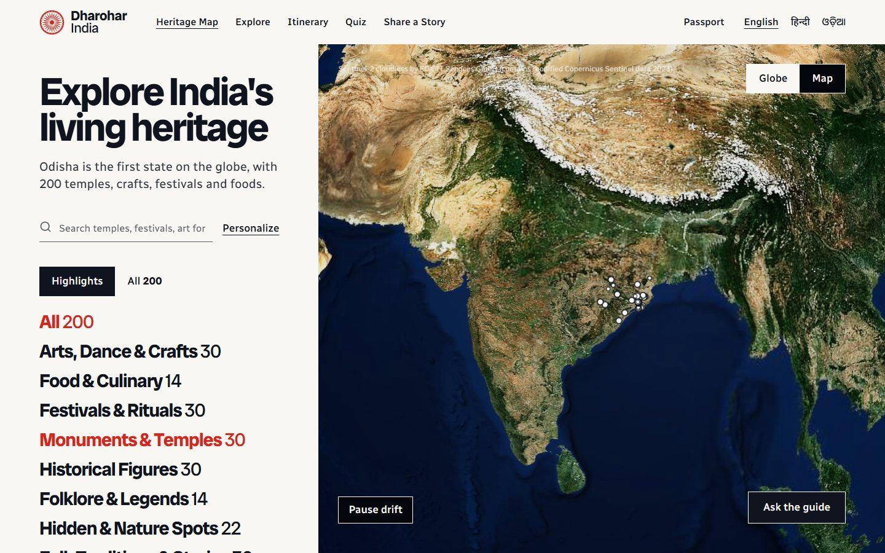

The left column is a large-type index of the eight categories with their counts: Arts, Dance & Crafts · Food & Culinary · Festivals & Rituals · Monuments & Temples · Historical Figures · Folklore & Legends · Hidden & Nature Spots · Folk Traditions & Stories.

- **Preview on hover or focus.** Pointing at a category glides the globe in on Odisha, shows every record of that kind and dims the rest. Moving away eases back out after a moment, so passing down the list does not jitter.
- **Choose** a category to filter the globe and the map to it.
- **Highlights / All 200.** The globe opens on a curated set of highlights; one switch shows every record.
- **Search** by name, place or kind from the search line above the index.

## 06 — The 2D map

The *Map* side of the toggle is a Leaflet map on **Esri World Imagery**, with the same records, the same links drawn as lines, and the same record panel. It is lighter than the globe and better for reading exact positions ([screenshot above](#03--every-record-where-it-began)).

## 07 — Darshak, the AI guide

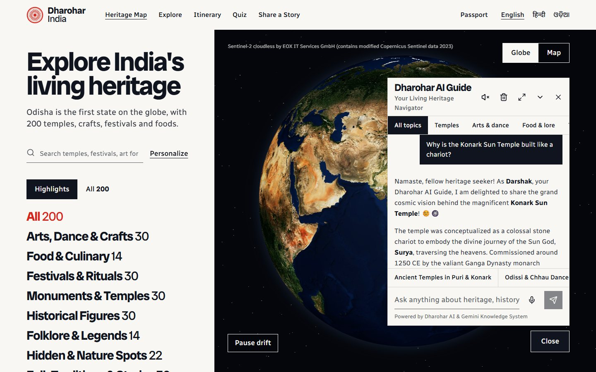

*Ask the guide* opens **Darshak**, a heritage guide powered by Google Gemini and grounded in Dharohar's own records.

- Each question is matched against the records and their links first; the answer is written from those, in the language the visitor is using.
- **Topic tabs** (All topics · Temples · Arts & dance · Food & lore) and suggested questions, which follow the record being viewed.
- **Voice:** speak a question (speech recognition) and have answers read aloud.
- **Resilient:** it tries a chain of Gemini models in turn (`GEMINI_MODELS`), each with a timeout. With no key or no reachable model it still answers, from a built-in knowledge base.
- The conversation stays for the browser tab (session storage); copy any answer with one click.

## 08 — Trip planner

<table>
  <tr>
    <td width="50%">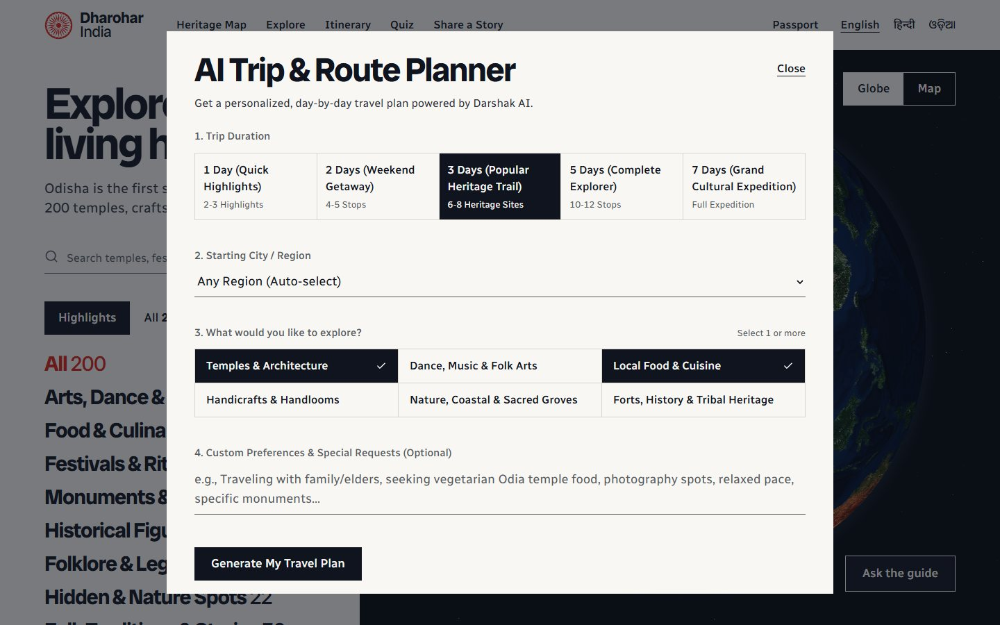</td>
    <td width="50%">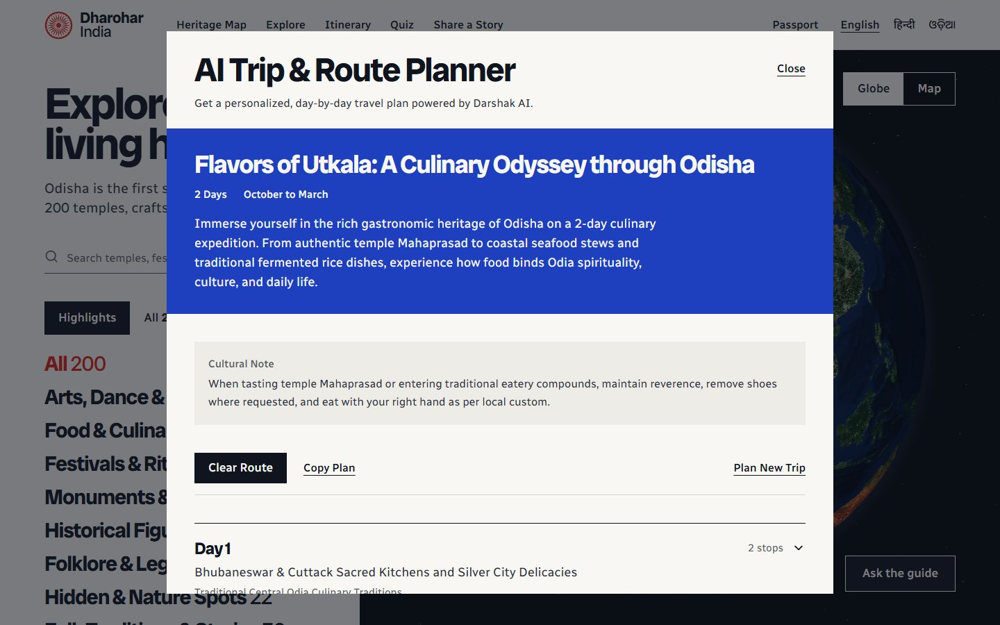</td>
  </tr>
</table>

**Itinerary** builds a day-by-day heritage trip with Gemini.

- Choose a length (1 to 7 days), themes (temples, dance and folk arts, food, handicrafts, nature and sacred groves, forts and tribal heritage), a starting point and any notes, such as travelling with elderly parents.
- The plan comes back with a title, the best season, a cultural note, and stops for each day drawn from Dharohar's records.
- The route is drawn on the globe leg by leg, in travel order. *Copy Plan* puts it on the clipboard; *Clear Route* removes it.

## 09 — Personalised map

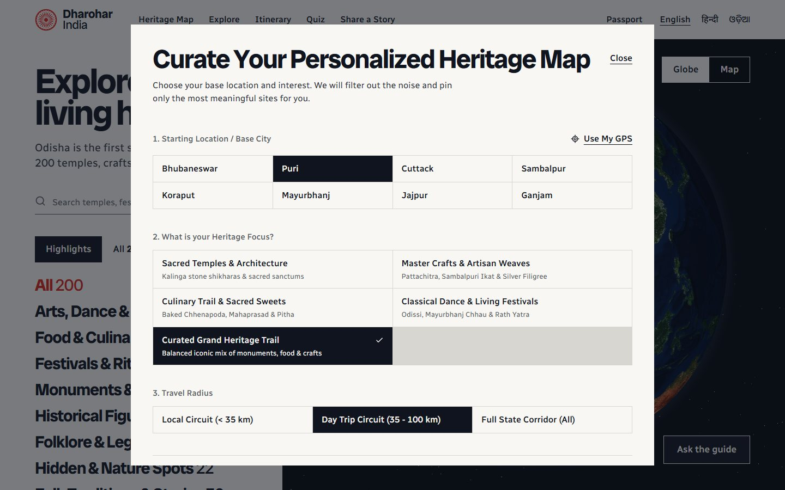

**Personalize** re-centres the map on what is relevant to you: pick a hub city (or use your GPS location), an interest and a radius. The choice is kept in the browser for the next visit; GPS coordinates never leave the device.

## 10 — Heritage quiz

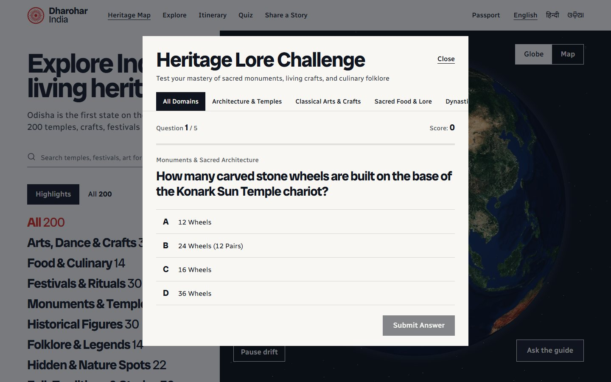

**Quiz** opens the *Heritage Lore Challenge*: rounds of five multiple-choice questions on monuments and architecture, classical arts and crafts, sacred food and lore, and dynasties. The options are shuffled each time and the score is kept as you go; records can carry their own questions too.

## 11 — Heritage passport

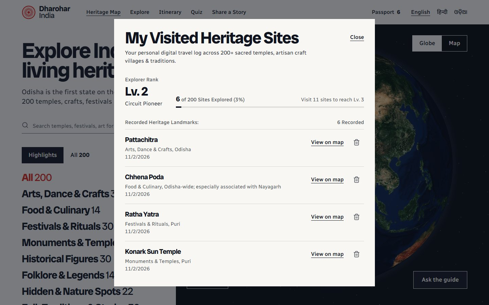

**Passport** is a personal log of the places you have visited. Mark a record visited from its panel and it is stamped here with the date. Explorer ranks rise with the count (Lv. 1 at one site, Lv. 2 at four, Lv. 3 at eleven), and each entry can jump back to its place on the map. Everything stays in your browser.

## 12 — Explore

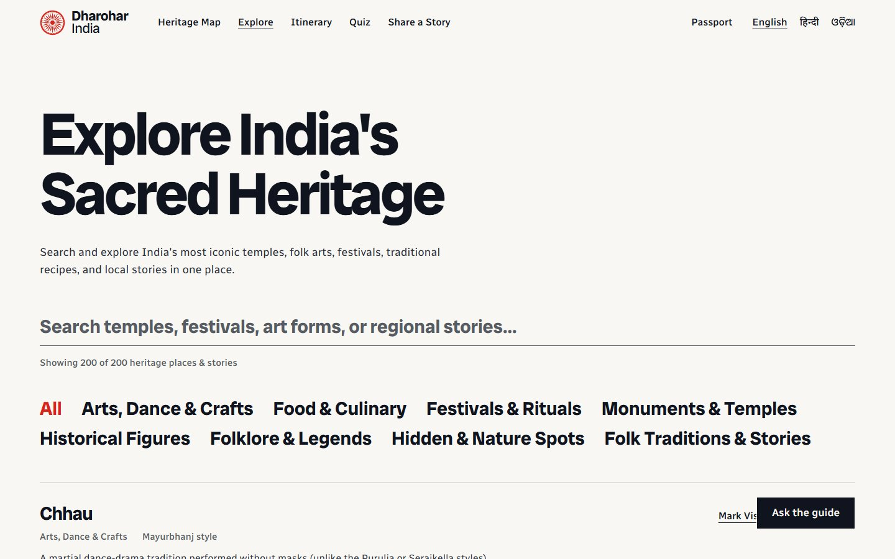

**Explore** (`/discover`) is the whole archive as an editorial list: one large search line, the categories as a type index, and every record with its place, description, *Mark visited* and *View on Map*.

## 13 — Share a story

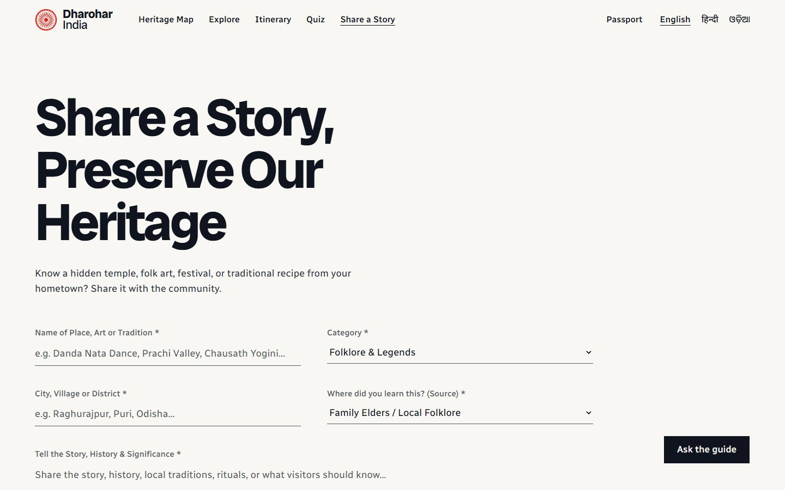

**Share a Story** (`/contribute`) lets anyone add what the archive is missing: oral lore, a lesser-known site, a craft, a recipe. Each story has a title, category, place, the story itself, its source (for example family elder lore) and an optional photo link. Stories are saved to the database; record pages also take visitors' opinions and travel tips.

## 14 — Three languages

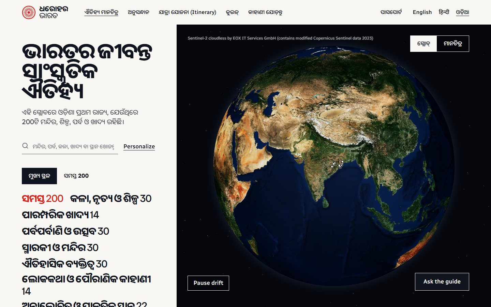

The whole interface, the record names and texts, the link labels and lore, and the AI guide's answers come in **English, हिन्दी and ଓଡ଼ିଆ**. The switch is in the top bar and is remembered. Each script uses its own typeface (Noto Sans Devanagari, Noto Sans Oriya) beside Radio Canada for Latin.

## 15 — Opening screen


The site opens on a calm screen while it loads: the Chakra turning slowly in the brand red, the name fading in and breathing, a line in English, Hindi and Odia, and a progress rule that names each stage (waking the server, gathering the records, drawing the globe).

- It is part of `index.html`, so it appears at once, before the app's JavaScript has arrived.
- It lifts only when the backend has answered **and** the home page's records and globe have loaded, so you never land on an empty page.
- If the server is slow, it says so after 12 seconds and offers *Continue anyway*, while it keeps checking.

## 16 — On a phone

<table>
  <tr>
    <td width="32%">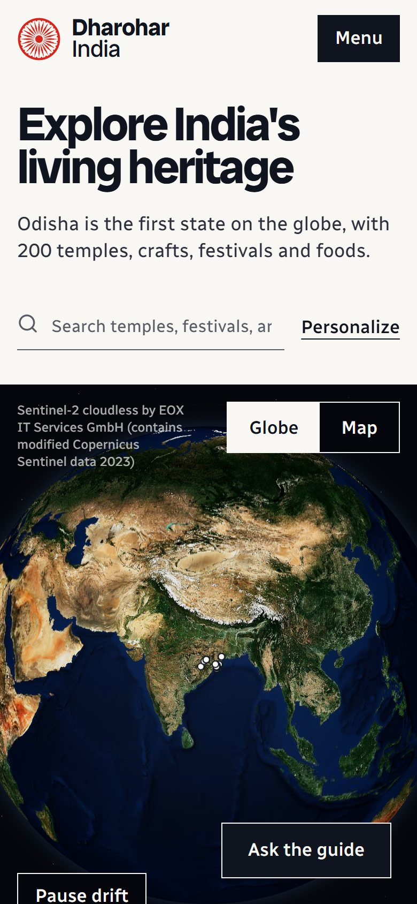</td>
    <td>

The layout reflows to one column: the introduction and search first, then the globe, then the category index, with the record panel below the globe. Navigation folds into a *Menu*. Every control keeps a touch target of at least 44 px.

  </td>
  </tr>
</table>

---

## Run it

The simplest way is Docker: it runs the backend, the frontend and everything they need with one command. See [DOCKER.md](./DOCKER.md) for the full guide.

```bash
git clone https://github.com/Roushan-2104/Dharoharv2.git
cd Dharoharv2
cp .env.example .env          # then fill in the values (ask the team for the real ones)
docker compose up --build
```

Open **http://localhost:5173**. Check the backend at **http://localhost:3000/api/health**:

```json
{ "status": "ok", "database": "connected", "chatbot": "ai" }
```

After pulling changes that add npm packages, rebuild with fresh dependency volumes: `docker compose up --build -V`.

<details>
<summary><b>Production-style build (Nginx)</b></summary>

```bash
docker compose -f docker-compose.prod.yml up --build -d
```

Nginx serves the built site at **http://localhost** (set `WEB_PORT` to use another port) and passes `/api` to the backend, which is not exposed to the host.

</details>

<details>
<summary><b>Without Docker (Node 22)</b></summary>

```bash
# Terminal 1: backend on http://localhost:3000
cd backend && npm install && npm run dev

# Terminal 2: frontend on http://localhost:5173
cd frontend && npm install && npm run dev
```

The Vite dev server passes `/api` to `http://localhost:3000` (change it with `VITE_PROXY_TARGET`).

</details>

<details>
<summary><b>A fresh database</b></summary>

Dharohar keeps its tables in their own Postgres schema, `dharohar`, so it can share a Supabase project with other tables. To create and fill it (safe to run again):

```bash
cd backend && npm run setup-db
# or, in Docker:
docker compose exec backend npm run setup-db
```

</details>

### Settings

| Variable | Used by | What it does | Without it |
|:--|:--|:--|:--|
| `GEMINI_API_KEY` | backend | The AI guide and trip planner | The guide answers from its built-in knowledge base |
| `DATABASE_URL` | backend, scripts | Postgres (e.g. the Supabase session pooler) for opinions, stories and quiz scores | The API serves the 200 bundled records; new opinions and stories last until restart |
| `DB_SCHEMA` | backend | Schema holding Dharohar's tables | `dharohar` |
| `GEMINI_MODELS` | backend | Models tried in order | `gemini-3.5-flash, gemini-flash-lite-latest, gemini-3.1-flash-lite` |
| `GEMINI_TIMEOUT_MS` | backend | Time allowed per model | `25000` |
| `CORS_ORIGINS` | backend | Sites allowed to call the API from a browser | `http://localhost:5173, http://127.0.0.1:5173` |
| `TRUST_PROXY` | backend | Set to `1` behind Nginx or another proxy | not set (the production compose sets it) |
| `VITE_API_URL` | frontend build | Absolute API address | empty: `/api` on the same site |
| `VITE_SATELLITE_TILES_URL` | frontend build | Another XYZ imagery source for the globe | Sentinel-2 cloudless by EOX |
| `WEB_PORT` | production compose | Host port for Nginx | `80` |

`.env` files are never committed; only `.env.example` is.

---

## How it works

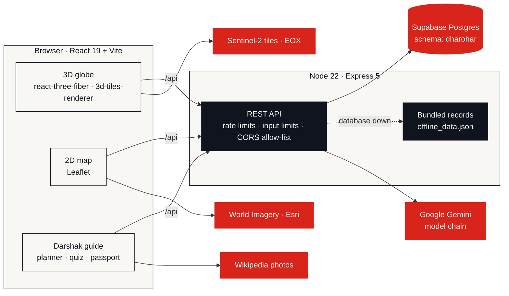

**A question to the guide**

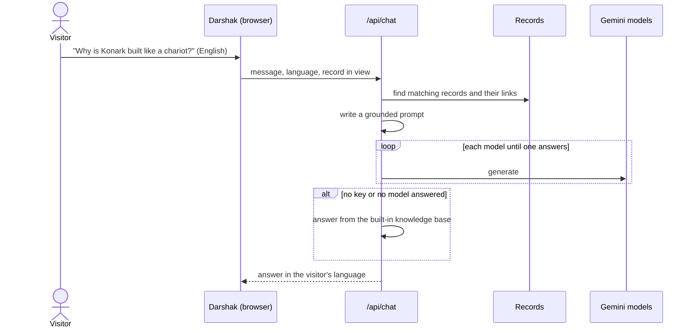

**Opening the site**

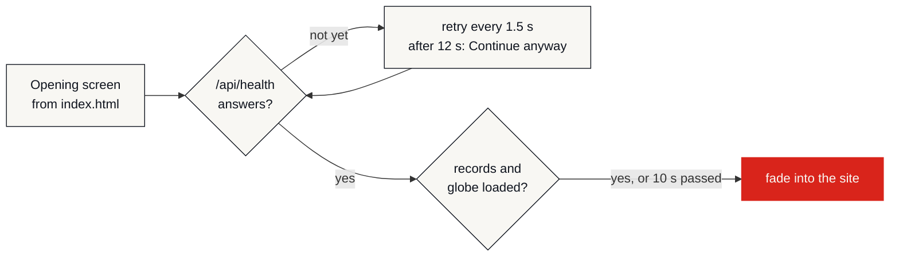

---

## API

Base: `http://localhost:3000` (or `/api` on the site itself).

| Method | Path | What it does | Limit |
|:--|:--|:--|:--|
| `GET` | `/api/health` | Server, database and AI status | |
| `GET` | `/api/entities` | All records with category and coordinates | |
| `GET` | `/api/entities/:id/connections` | A record's links (curated first, then nearby cultural neighbours) | |
| `GET` | `/api/entities/:id/opinions` | Visitors' opinions on a record | |
| `POST` | `/api/entities/:id/opinions` | Add an opinion | 10 per 15 min |
| `GET` | `/api/quizzes` | Quiz questions, optionally by category | |
| `GET` | `/api/quizzes/entity/:entityId` | Questions about one record | |
| `POST` | `/api/quizzes/submit` | Score a quiz round | 20 per min |
| `POST` | `/api/chat` | Ask the guide | 20 per min |
| `POST` | `/api/itinerary/generate` | Plan a trip | 10 per 5 min |
| `POST` | `/api/contribute` | Share a story | 10 per 15 min |

<details>
<summary><b>Example requests</b></summary>

```jsonc
// POST /api/chat
{ "message": "Why is the Konark Sun Temple built like a chariot?",
  "language": "en",                                   // "en" | "hi" | "or"
  "entityContext": { "name": "Konark Sun Temple" } }  // optional: the record in view

// POST /api/itinerary/generate
{ "days": 2, "themes": ["temples", "food"], "startingRegion": "Bhubaneswar",
  "customNotes": "Travelling with elderly parents", "language": "en" }

// POST /api/contribute   (title and lore are required)
{ "title": "The Weeping Banyan of Kakatpur", "category": "Oral Tradition & Folklore",
  "location": "Kakatpur, Puri", "lore": "Village elders tell that…",
  "sourceType": "Family Elder Lore", "contributor": "Anonymous", "photoUrl": "" }
```

</details>

---

## Data

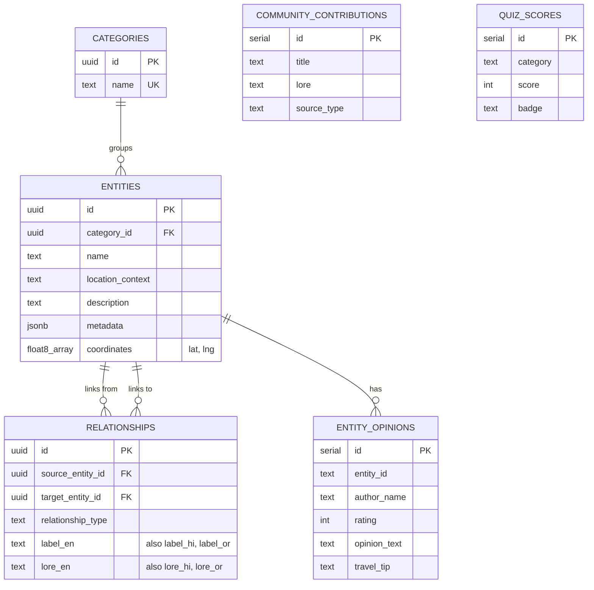

All of these live in the `dharohar` schema. `backend/setup_db.js` creates them and fills them from the bundled records; it never touches tables outside the schema.

**Sources.** The records come from the CSV datasets in [`data/`](data/): monuments, historical personalities, arts and crafts, festivals, regional traditions, lesser-known places, legends and stories, and two food directories. [`scripts/build_offline_data.js`](scripts/build_offline_data.js) turns them, the curated links and the verified locations into `backend/offline_data.json`, which the API serves whenever the database cannot be reached.

**Stored in the visitor's browser only:** the language (`dharohar_language`), passport stamps (`dharohar_visited_sites`), the personalised map (`dharohar_user_preference`) and, for the tab, the guide conversation (`dharohar_chat_history`).

---

## Security and resilience

| | |
|:--|:--|
| **Rate limits** | Per-IP limits on every endpoint that writes or calls the AI (see [API](#api)), to protect the Gemini quota and the database. |
| **Input limits** | Request bodies capped at 50 KB; messages and notes at 1,000 characters; trips at 14 days; field lengths checked on opinions and stories. |
| **CORS** | An allow-list (`CORS_ORIGINS`) instead of any origin. In production the site and API share one origin through Nginx. |
| **Errors** | JSON errors without stack traces. |
| **Containers** | The backend image runs as the unprivileged `node` user, with a health check; in production only Nginx is exposed. |
| **Secrets** | Read only from environment variables; `.env` files are git-ignored. |
| **Offline mode** | If Postgres is unreachable, the API serves the 200 bundled records and keeps new opinions and stories in memory; the guide falls back to its built-in answers when no model responds. A demo keeps working with no database and no AI key. |

---

## Design

The interface follows one system, called **Grid**: paper and ink, one red mark, ruled lines instead of boxes, and type that does the work.

| Token | Value | Use |
|:--|:--|:--|
| Paper | `#f8f7f3` | Page background |
| Ink | `#0f141e` | Text, rules, dark controls |
| Mark | `#d9241b` | The brand red: the Chakra, active states, the one accent per view |
| Field | `#1f40be` | Large blue fields, such as a generated trip's title band |
| Space | `oklch(12% 0.015 266)` | Behind the globe |

- **Type:** Radio Canada Big for display, set large and tight; Radio Canada for text; Noto Sans Devanagari and Noto Sans Oriya for Hindi and Odia.
- **Shape:** square corners, no shadows, glows or gradients; 1 px rules separate content.
- **Motion:** purposeful and calm (the arrival sweep, arcing flights, links that draw themselves, panels that rise in), all switched off under reduced motion.
- **Access:** visible focus rings, 44 px touch targets, real buttons and labels for screen readers.
- **Mark:** a 24-spoke Chakra in the brand red is the logo, the favicon and the centre of the opening screen.

---

## Project structure

```text
Dharoharv2/
├── backend/                 Express API
│   ├── server.js            routes, rate limits, Gemini model chain, offline fallback, trip planner
│   ├── setup_db.js          creates and fills the dharohar schema (npm run setup-db)
│   ├── offline_data.json    the 200 records and 37 links, served when the database is down
│   └── Dockerfile
├── frontend/                React 19 + Vite
│   ├── index.html           includes the opening screen
│   ├── public/              favicon (the Chakra) and Blue Marble textures
│   └── src/
│       ├── splash.js        lifts the opening screen when the site is ready
│       ├── config/          API base, theme colours, satellite imagery source
│       ├── context/         language and translations (EN, HI, OR), passport
│       ├── pages/           Explore, Share a Story
│       └── components/
│           ├── Hero/        globe, satellite surface, camera, links, 2D map, panels, planner
│           ├── Chatbot/     Darshak
│           ├── Quiz/  Passport/  Navigation/  Brand/  Layout/
├── data/                    source CSVs and entity_locations.json (verified places)
├── scripts/                 data build and seeding
├── docs/readme/             the images in this README
├── docker-compose.yml       development stack
├── docker-compose.prod.yml  production stack (Nginx)
└── DOCKER.md                setup guide for the team
```

**Stack:** React 19 · React Router 7 · Vite 8 · Tailwind CSS 3 · three.js · @react-three/fiber · @react-three/drei · 3d-tiles-renderer · Leaflet · Node 22 · Express 5 · pg · @google/generative-ai · Supabase Postgres · Docker · Nginx.

---

## Roadmap

- [x] 3D globe with streaming satellite imagery, and a 2D map
- [x] Every record at its verified place of origin
- [x] Curated links in three languages, drawn on the globe
- [x] Darshak guide with a model chain and offline answers
- [x] Trip planner, personalised map, quiz and passport
- [x] Community stories and opinions saved to Postgres
- [x] Docker for the team, its own database schema, rate limits and input checks
- [ ] Moderation for community stories before they appear
- [ ] Records for more states, starting with neighbours of Odisha
- [ ] Source and trust tags on records (ASI record, academic, community lore)
- [ ] A timeline view across the centuries
- [ ] Automated tests and CI

## Known limitations

- After the first database error the API stays in offline mode until it restarts.
- In offline mode, new opinions and stories are kept in memory only.
- The Hindi and Odia text, including the opening screen's lines, would benefit from a native speaker's review.
- Ten places are estimated to within a few kilometres (`"approximate": true` in `data/entity_locations.json`); some origins of crafts and dishes that are made in many places are a judgement call.
- The Sentinel-2 imagery licence (CC BY-NC-SA 4.0) allows non-commercial use only.

## Credits

- **Smart India Hackathon 2026**, for the problem of showing India's cultural heritage.
- **Sentinel-2 cloudless** by EOX IT Services GmbH (contains modified Copernicus Sentinel data 2023) for the globe imagery; **Esri, Maxar, Earthstar Geographics** for the 2D map imagery; **NASA Blue Marble** for the base Earth.
- **Wikidata** and **OpenStreetMap** contributors for place coordinates; **Wikipedia and Wikimedia Commons** for photographs.
- **NASA-AMMOS 3DTilesRendererJS**, **three.js**, **pmndrs** (react-three-fiber, drei) and **Leaflet**.
- **Radio Canada** and **Noto** typefaces from Google Fonts.
- The Archaeological Survey of India, Odisha Tourism and the community historians whose knowledge the records draw on.

## License

The source code is released under the [MIT License](./LICENSE): use it, change it and share it, keeping the copyright notice.

**All rights reserved** in the Dharohar name, wordmark and logo, the Smart India Hackathon 2026 idea document (`Digital_Heritage_Knowledge_System_Full_Document.docx`, `docx_content.txt`) and `demo.mp4`. These are not covered by the MIT License.

Third-party imagery, data and fonts keep their own terms; see [Credits](#credits) and the [LICENSE](./LICENSE) file.

Copyright © 2026 Roushan Sharma and Manavendra Gupta.

<br>

<p align="center">
  <br>
  <b>Dharohar</b> · धरोहर · ଧରୋହର<br>
  <sub>Culture is identity. संस्कृति ही पहचान। ସଂସ୍କୃତି ହିଁ ପରିଚୟ।</sub>
</p>
